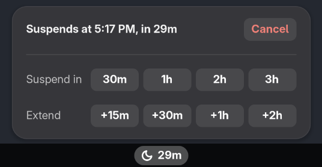
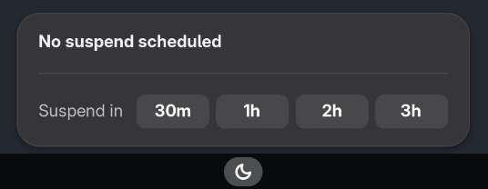

# suspend-later

Suspend your computer after a delay. Useful when you leave home but want long jobs to keep
running for a while first.

It replaces typing `sleep 3600 && systemctl suspend` in a terminal. You can see the schedule,
change it, or cancel it, from a panel icon or the command line.



## Requirements

- Linux with systemd and `/usr/bin/python3`
- GNOME Shell for the panel icon (optional; the command line works without it)

Tested on Fedora 42 with GNOME 48. The extension also declares GNOME 49 and 50, but has not
been tested there. GNOME often changes its extension APIs between versions, so a future GNOME
may break the panel icon. The command line will keep working, because it only uses systemd.

## Install

```
./install.sh
```

This links `bin/suspend-later` into `~/.local/bin` and the extension into GNOME Shell.

On Wayland, log out and back in once to load the extension. Later, `git pull` updates
everything. The command line picks up changes at once; the extension needs another
logout and login.

## Command line

```
suspend-later 1h            # suspend in 1 hour (replaces any existing schedule)
suspend-later 90m           # also 1h30m, 2.5h, or 45 (a bare number means minutes)
suspend-later 11pm          # at the next 11 PM (also 5:30pm, 23:30)
suspend-later +30m          # add 30 minutes (or schedule, if nothing is pending)
suspend-later cancel
suspend-later               # show status: "Suspend scheduled at 5:10 PM (in 58m)."
suspend-later 10s --dry-run # try it out: logs instead of suspending
```

Add `--json` to any command to get the status as JSON.

## Panel icon

A moon icon in the top bar.



- **While a suspend is scheduled,** it shows the time left next to the moon, like `58m`.
- **Click it** to see when the suspend happens, and to:
  - **Suspend in** 30m, 1h, 2h, or 3h
  - **Extend** by 15m, 30m, 1h, or 2h
  - **Cancel**
- **Bright text** means a real suspend is coming. **Dim, italic text** means a dry run.
- **Yellow** means less than 5 minutes are left, in case you are still at the desk.
- **Orange** means the last suspend attempt failed. Open the menu to see why.

Changes made from the terminal or over SSH show up in the panel right away.

## How it works

- **The schedule is a systemd timer.** `suspend-later` creates a user timer called
  `suspend-later.timer`. When it fires, it runs `systemctl suspend`. Because systemd owns it,
  the schedule survives closing the terminal and keeps working even if the panel icon breaks.
- **There is only one schedule.** Setting a new time or extending replaces the old timer.
- **The panel icon is only a display.** It runs `suspend-later --json` and shows the result.
  It never suspends anything itself.
- **Suspending early cancels the schedule.** If you come back and suspend the computer
  yourself, the old schedule is dropped. Otherwise it would resume counting after you wake
  the computer and suspend it again unexpectedly.
- **Logging out cancels the schedule.** systemd stops your user timers when you log out.
  That is fine for leaving the house, where you stay logged in.

To see what happened when a timer fired:

```
journalctl --user -u suspend-later.service
```

## JSON output

```json
{"active": true, "deadline": "2026-11-09T17:10:00+08:00", "deadline_epoch": 1794215400.575,
 "remaining_seconds": 3600, "dry_run": false}
```

When nothing is scheduled: `{"active": false}`. If the last suspend attempt failed, an
`"error"` field explains why.

## Development

`dev/headless-capture.sh` starts a throwaway GNOME Shell on a virtual display, checks that the
extension loads without errors, and saves a screenshot in `scratch/`. Run it before logging out
to test extension changes.

## License

MIT. See [LICENSE](LICENSE).
